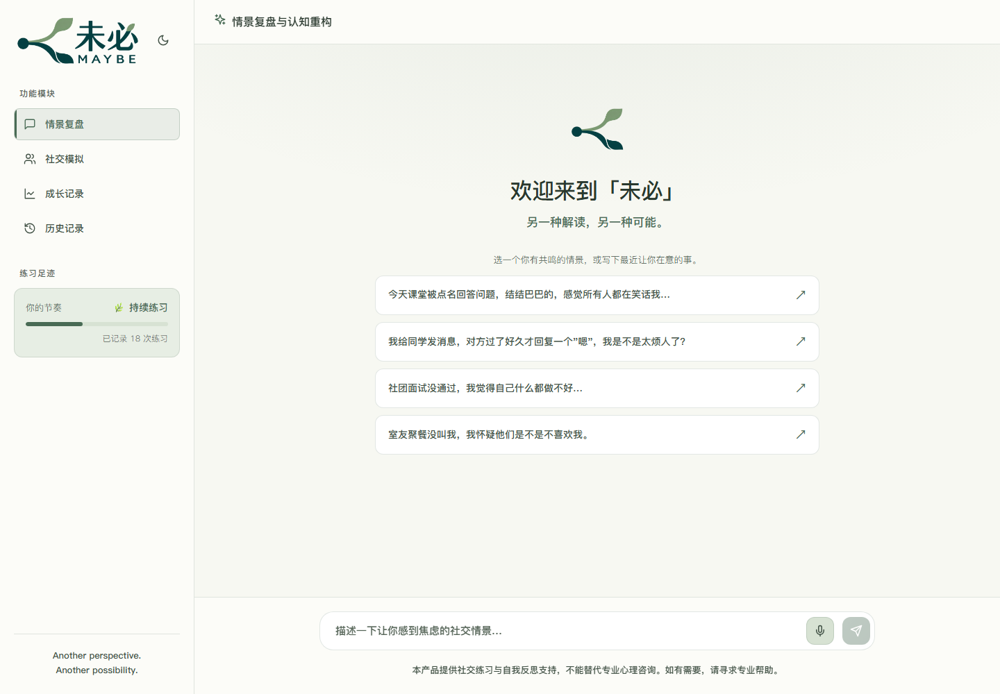

# 未必 MAYBE

> 另一种解读，另一种可能。
>
> Another perspective. Another possibility.

未必是一款围绕社交焦虑话题的练习与复盘应用。用户可以描述一次让自己在意的社交经历，梳理当时的情绪与想法；也可以选择校园或求职情景，练习开口、回应和表达。对话引导参考认知行为疗法（CBT）的提问方式。

[在线体验](https://www.modelscope.cn/studios/Eunomio/Maybe?mode=full) · [部署说明](FULL_DEPLOY.md) · [产品需求文档](prd.md)

## 当前功能

- **情景复盘**：写下自己的经历，或点击示例填入输入框，确认后发送。回复逐步显示，并附上情绪和思维模式提示。
- **社交模拟**：选择场景与角色参数，练习一段对话。当前有和室友聊天、向同学借笔记、社团面试、找老师答疑、活动中认识新朋友、实习面试六个场景。
- **“怎么办？”**：在模拟对话中写下犹豫的原因，查看回复建议及其理由；采纳后先填入输入框，由用户决定是否发送。
- **练习回顾与续聊**：点击“结束并回顾”生成本次练习报告，关闭回顾后可以继续对话。打开自己的历史记录即可接着聊，消息追加到原来的会话中；社交模拟沿用保存的场景和角色设置。复盘与模拟分别保留当前聊天、未发送的文字和场景选择，切换模块后可继续。历史记录支持查看报告、补生成报告和确认后删除记录。
- **成长记录**：查看练习次数、中文情绪统计和常见思维模式。点击“生成成长回顾”，根据最近最多 10 次练习获取综合判断、已有尝试与具体建议，可点击引用回看原对话。回顾会保存，记录变化后可以更新。侧栏根据练习次数显示“慢慢尝试”“持续练习”“积累经验”“用自己的节奏”。
- **界面**：暖白与绿色的浅色主题、深色主题、手机导航和浏览器支持时的语音转文字。深浅主题中的 Logo 保持相同尺寸。

## 界面预览



[查看深色界面](docs/images/maybe-dark.png) · [查看手机界面](docs/images/maybe-mobile.png)

## 技术与模型配置

前端使用 React 19、Vite 8 和 CSS，后端使用 FastAPI、SQLAlchemy 与 SQLite。前后端分开启动用于本地开发；魔搭部署通过一个 Docker 容器提供页面与 `/api`。

当前线上版本使用校内 OpenAI 兼容服务，配置为 `LLM_PROVIDER=openai`、`OPENAI_BASE_URL=https://chat.ecnu.edu.cn/open/api/v1`、`OPENAI_MODEL=ecnu-max`。项目也支持 DeepSeek。访问密钥保存在本地环境文件或托管平台的密钥设置中。

建议使用 Python 3.11 和 Node.js 24，与部署镜像保持一致。

## 本地运行

以下命令在项目根目录执行。首次运行需要安装依赖；已有环境可跳过创建、安装和复制配置的步骤。

### 1. 准备后端

```powershell
python -m venv backend/.venv
.\backend\.venv\Scripts\python.exe -m pip install -r backend/requirements.txt
if (-not (Test-Path backend/.env)) { Copy-Item .env.example backend/.env }
```

在 `backend/.env` 中填写 `OPENAI_API_KEY`。若该文件已存在，请直接编辑并保留原配置。

在第一个 PowerShell 窗口启动后端：

```powershell
cd backend
.\.venv\Scripts\python.exe -m uvicorn main:app --reload --env-file .env --host 127.0.0.1 --port 8000
```

macOS/Linux 可用 `backend/.venv/bin/python` 安装依赖，并在 `backend` 目录通过 `.venv/bin/python -m uvicorn main:app --reload --env-file .env --port 8000` 启动。

### 2. 启动前端

在第二个 PowerShell 窗口执行：

```powershell
cd frontend
npm.cmd ci
npm.cmd run dev
```

macOS/Linux 将 `npm.cmd` 换成 `npm`。

打开 [http://localhost:5173](http://localhost:5173)。Vite 将 `/api` 请求转发到本地后端。修改前端会自动刷新，修改后端会自动重启；在对应窗口按 `Ctrl+C` 停止服务。

后端健康检查为 [http://localhost:8000/api/health](http://localhost:8000/api/health)，接口文档为 [http://localhost:8000/docs](http://localhost:8000/docs)。

本地默认数据库为 `backend/echo.db`。这个文件名与默认会话用户标识为兼容已有记录而保留，产品名称为“未必 MAYBE”。

后端启动时会为旧数据库补充保存模拟设置所需的字段，保留原有记录。旧的模拟记录若未保存角色设置，会依据已有对话继续；新建模拟会保存场景、角色选项和开场白。续聊后原有单次报告需要重新生成，成长回顾也会提示更新。

## 使用示例与比赛演示

点击页面右上角的“查看使用示例”，可以查看独立的“林澄（虚构示例）”资料。包含最近四周的 8 次练习（5 次复盘、3 次模拟）、32 条消息、10 次情绪记录、8 份单次回顾和 1 份综合成长回顾。成长回顾的引用可打开对应对话。

示例内容由 `backend/fixtures/demo_journey.json` 提供，对话、报告和建议均为编写的虚构资料，不用于说明实际使用效果。示例只供查看，不能追加或删除；点击“返回我的练习”或“开始自己的练习”继续自己的对话。原有记录保持独立，真实练习的回复与成长回顾仍调用已配置的模型服务。

首次查看会自动导入，重复查看不会添加重复记录或改变日期。本地也可提前运行：

```powershell
.\backend\.venv\Scripts\python.exe deploy/seed-demo.py
```

打开 [本地使用示例](http://localhost:5173/?example=1)。建议按“成长记录 → 点击参考练习 → 历史记录 → 查看报告 → 返回我的练习”的顺序展示。重新发布完整应用后，魔搭同样可使用页面上的示例入口，无需上传数据库。

## 验证与部署

前端检查：

```powershell
cd frontend
npm.cmd run lint
npm.cmd run build
```

成长回顾的后端检查使用独立临时数据库，不调用真实模型：

```powershell
cd backend
.\.venv\Scripts\python.exe -m unittest discover -s tests -v
```

- [魔搭、国内服务器及原有 Render + Vercel 部署](FULL_DEPLOY.md)：React + FastAPI 完整版本。
- [Streamlit 部署](STREAMLIT_DEPLOY.md)：复用对话逻辑的备用界面，与 React 版的界面及历史保存方式不同。

GitHub 仓库路径保持为 `Eunomio/echo`。本地密钥、数据库、依赖目录、构建产物和临时发布文件不提交到仓库。

## 使用提示

本产品提供社交练习与自我反思支持，不能替代专业心理咨询。如有需要，请寻求专业帮助。
